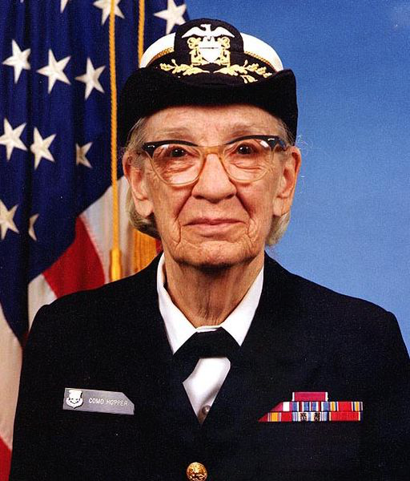
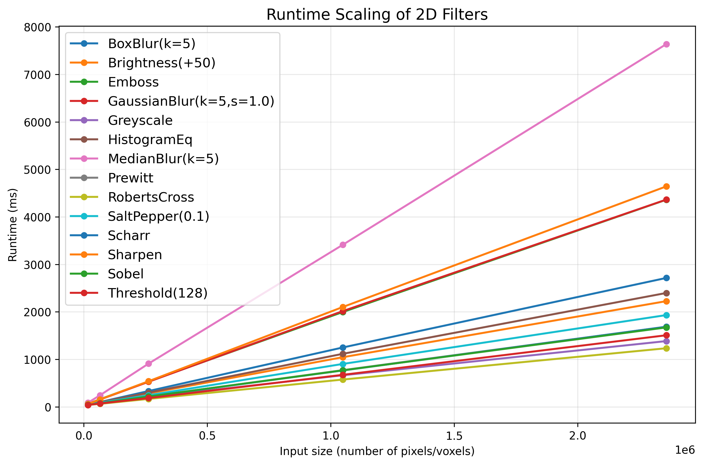
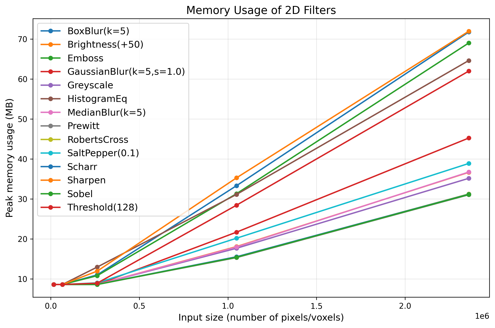
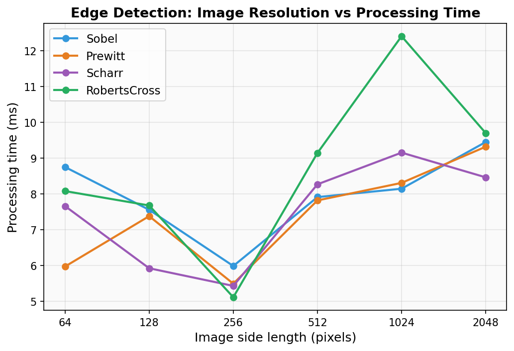
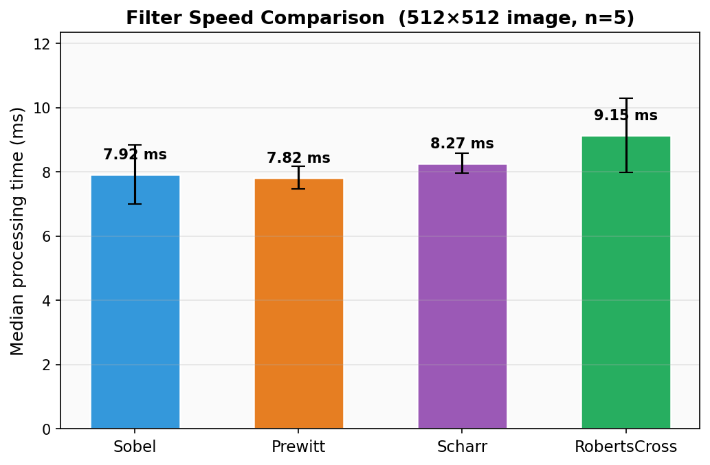
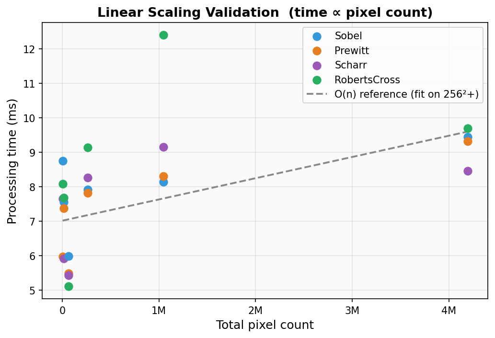

# APImageFiltersKruskal

A C++17 image and volume processing project for the Advanced Programming course. The application supports 2D image filters, 3D volume loading, slice extraction, and intensity projection from stacks of scan images.

## Project Overview

This project implements a command-line image processing toolkit in modern C++. It is designed around two related tasks:

- processing a single 2D image with classic image enhancement and analysis filters
- processing a 3D volume built from a sequence of 2D scan slices

For 2D images, the program can improve contrast, blur noise, detect edges, sharpen detail, and apply intensity-based transformations. For 3D data, the program reads a folder of ordered scan slices as one volume, then produces a 2D output image by either extracting a slice or computing a projection across the volume.

The project is structured as a reusable C++ library plus a command-line executable. Most of the image and volume operations are implemented as separate classes, which keeps the code modular and makes individual features easier to test.

## Preview


## Features

- 2D image processing for `.png` and `.jpg` outputs
- Greyscale conversion
- Manual and automatic brightness adjustment
- Histogram equalisation in `HSV` or `HSL`
- Blur filters: `Gaussian`, `Box`, and `Median`
- Edge detection: `Sobel`, `Prewitt`, `Scharr`, and `RobertsCross`
- Laplacian sharpening
- Emboss filtering with configurable direction and strength
- Salt-and-pepper noise
- Thresholding in `HSV` or `HSL`
- 3D volume loading from image stacks
- Volume slice extraction on `XZ` and `YZ`
- Volume projections: `MIP`, `MinIP`, `meanAIP`, and `medianAIP`

## What The Project Does

The executable accepts command-line arguments that describe:

- what kind of data to load
- which filters or processing steps to apply
- where to save the final output image

In image mode, the program loads one input image, applies one or more filters in the order they are given, and writes the final processed image.

In volume mode, the program loads a stack of image files as a 3D dataset. It can optionally blur the volume first, then either:

- extract a planar slice from the data
- compress the volume into a single 2D image using an intensity projection

This makes the project suitable for both standard image editing tasks and simple medical or scientific volume visualisation workflows.

## Core Components

### Image processing

The image processing part of the project works on a single `Image` object and supports a pipeline of operations. Important filters include:

- greyscale conversion for intensity-only processing
- brightness adjustment for manual or automatic exposure correction
- histogram equalisation for contrast enhancement
- blur filters for denoising and smoothing
- edge detectors for highlighting boundaries and structure
- sharpening and embossing for detail enhancement
- thresholding for segmentation-style output

### Volume processing

The volume processing part builds a `Volume` object from multiple numbered image slices. After loading the data, the project can:

- extract an `XZ` or `YZ` cross-sectional slice
- compute `MIP`, `MinIP`, `meanAIP`, or `medianAIP` projections
- apply supported blur filters before the slice or projection step

This is useful when working with CT-style or anatomy-style scan data, where the information is spread across many sequential 2D images.

### Command-line interface

The main program parses command-line options, decides whether it is in image mode or volume mode, applies the requested operations, and saves the result. This gives the project a simple interface for testing, demonstrations, and scripted usage.

## Classes And Module Responsibilities

### Core data classes

- `Image`: stores 2D image data, pixel access helpers, file loading/saving, and colour-space conversion utilities such as `HSV` and `HSL`
- `Volume`: stores a 3D stack of slices as one voxel buffer and provides indexed voxel access for volume algorithms

### Shared abstraction layers

- `Filter`: abstract base class for operations that can modify an `Image` and, where relevant, a `Volume`
- `ConvFilter`: shared base class for convolution-based filters, including single-kernel effects and dual-kernel edge detectors
- `Kernel`: lightweight structure used to represent convolution matrices

### Sample input images



### Basic image filters

Purpose: these filters change pixel intensity or contrast directly and are useful for preprocessing, visual enhancement, and simple segmentation.

- `GrayScale`: converts an RGB image into grayscale intensity values
- `Brightness`: adjusts brightness using either a fixed offset or an automatic average-intensity correction
- `HistogramEqualisation`: improves contrast by redistributing intensity values in grayscale, `HSV`, or `HSL`
- `Threshold`: converts an image into a binary black-and-white result based on an intensity threshold
- `SaltAndPepper`: injects impulse noise for testing noise removal behaviour

Suggested showcase:


Caption: place a side-by-side or collage image here to show contrast improvement, grayscale conversion, thresholding, or noise injection on the same source image.

### Blur and denoising filters

Purpose: these filters reduce noise and smooth local variation before later analysis steps such as edge detection or thresholding.

- `BoxBlurFilter`: performs simple local averaging on 2D images
- `GaussianBlurFilter`: applies Gaussian smoothing to both images and volumes
- `MedianBlurFilter`: removes impulsive noise using local medians in either 2D or 3D

Suggested showcase:


Caption: use one figure comparing the original image with box blur, Gaussian blur, and median blur so the differences in smoothing behaviour are immediately visible.

### Convolution-based enhancement filters

Purpose: these filters emphasise local structure and visual texture using convolution kernels.

- `SharpenFilter`: enhances local contrast using a Laplacian-style kernel
- `EmbossFilter`: creates a relief-style shading effect with configurable direction, strength, and colour-space handling

Suggested showcase:


Caption: show sharpening and embossing on the same input image so readers can compare detail enhancement against stylised surface relief.

### Edge detection filters

Purpose: these filters estimate intensity gradients and highlight boundaries, contours, and structural transitions in the image.

- `SobelFilter`: detects horizontal and vertical gradients using the Sobel operator
- `PrewittFilter`: performs edge detection with the Prewitt operator
- `ScharrFilter`: performs edge detection with improved rotational symmetry compared with Sobel
- `RobertsCrossFilter`: uses compact 2x2 diagonal kernels for fast edge detection

Suggested showcase:


Caption: this section works best with a four-panel comparison using the same source image, one panel per edge detector.

### Volume analysis utilities

Purpose: these modules convert a full 3D scan volume into interpretable 2D outputs for inspection and analysis.

- `Slice`: extracts 2D cross-sections such as `XZ` and `YZ` from a 3D volume
- `Projection`: generates projected 2D images such as `MIP`, `MinIP`, `meanAIP`, and `medianAIP`

Caption: include either one multi-panel figure with `XZ`, `YZ`, and projection outputs, or one representative scan result with a short label for each method.

### Program entry and build modules

- `main.cpp`: command-line entry point that parses arguments, dispatches image or volume workflows, and saves the output
- `CMakeLists.txt`: defines the reusable library, executable, and test targets
- `tests/`: contains unit tests and command-line behaviour tests for validating the implementation

Recommended image asset locations:

- `docs/effects/basic_filters.png`
- `docs/effects/blur_filters.png`
- `docs/effects/enhancement_filters.png`
- `docs/effects/edge_filters.png`
- `docs/effects/volume_processing.png`

### Performance plots











## Processing Flow

### Image mode

1. Read the input image with `-i`.
2. Apply the requested filters from left to right.
3. Save the result to the output path.

### Volume mode

1. Read the volume prefix with `-d`.
2. Collect matching slice files from disk.
3. Optionally apply a volume blur.
4. Produce either a slice or a projection.
5. Save the generated 2D image.

## Command-Line Summary

The program is controlled entirely through command-line arguments. It always begins by selecting an input source and always ends with an output image path.

General command shapes:

```bash
./build/APImageFiltersKruskal -i <input_image> [operations...] <output_image>
./build/APImageFiltersKruskal -d <volume_prefix> [options...] (-s ... | -p ...) <output_image>
```

### Image mode summary

Main image options:

- `-g`, `--greyscale`
- `-b`, `--brightness <value|auto>`
- `-h`, `--histogram [HSV|HSL]`
- `-r`, `--blur <Gaussian|Box|Median> <size> [stdev]`
- `-e`, `--edge <Sobel|Prewitt|Scharr|RobertsCross>`
- `-L`, `--sharpen`
- `-m`, `--emboss <strength> <NW|NE|SE|SW> [HSV|HSL]`
- `-n`, `--saltpepper <amount>`
- `-t`, `--threshold <value> [HSV|HSL]`

These operations can be chained, and they are applied from left to right.

### Volume mode summary

Main volume options:

- `-f`, `--first <index>`
- `-l`, `--last <index>`
- `-x`, `--extension <ext>`
- `-r`, `--blur <Gaussian|Median> <size> [stdev]`
- `-s`, `--slice <XZ|YZ> <index>`
- `-p`, `--projection <MIP|MinIP|meanAIP|medianAIP>`

In volume mode, the command must include either a slice option or a projection option so the program knows how to generate the final 2D output image.

### Typical commands

```bash
./build/APImageFiltersKruskal -i Images/gracehopper.png -g output_gray.png
./build/APImageFiltersKruskal -i Images/stinkbug.png -r Gaussian 5 2.0 output_blur.png
./build/APImageFiltersKruskal -i Images/vh_ct.png -e Sobel output_edges.png
./build/APImageFiltersKruskal -d Scans/TestVolume/vol -s XZ 16 output_slice.png
./build/APImageFiltersKruskal -d Scans/TestVolume/vol -p MIP output_mip.png
```

For the full option reference, parameter rules, and more examples, see [command_line_options.md](command_line_options.md).

## Repository Structure

```text
.
├── src/                  Core image, filter, volume, slice, projection, and CLI code
├── tests/                Unit tests and command-line behaviour tests
├── Images/               Sample 2D images for filter experiments
├── Scans/TestVolume/     Example ordered scan slices for volume input
├── docs/                 Benchmark plots and supporting documentation
├── command_line_options.md
└── CMakeLists.txt
```

## Build

First clone the repository:

```bash
git clone <[repo-url](https://github.com/ese-ada-lovelace-2025/advanced-programming-group-kruskal.git)>
cd advanced-programming-group-kruskal
```

Install CMake and a C++ compiler if needed.

### macOS

```bash
brew install cmake gcc
mkdir -p build
cd build
CC=gcc-15 CXX=g++-15 cmake ..
cmake --build .
```

### Ubuntu / WSL

```bash
sudo apt update
sudo apt install build-essential cmake gdb
mkdir -p build
cd build
cmake ..
cmake --build .
```

After building, the executable will be:

```bash
build/APImageFiltersKruskal
```

## Usage

The program works in two modes:

- image mode with `-i <input_image>`
- volume mode with `-d <volume_prefix>`

The last argument must always be the output image path.

Full option details are documented in [command_line_options.md](command_line_options.md).

### Image processing examples

Convert to greyscale:

```bash
./build/APImageFiltersKruskal -i Images/gracehopper.png -g output_gray.png
```

Apply Gaussian blur:

```bash
./build/APImageFiltersKruskal -i Images/stinkbug.png -r Gaussian 5 2.0 output_blur.png
```

Run Sobel edge detection:

```bash
./build/APImageFiltersKruskal -i Images/vh_ct.png -e Sobel output_edges.png
```

Chain multiple operations:

```bash
./build/APImageFiltersKruskal -i Images/gracehopper.png -g -r Median 3 -L output_combo.png
```

### Volume processing examples

Extract an `XZ` slice from the sample volume:

```bash
./build/APImageFiltersKruskal -d Scans/TestVolume/vol -s XZ 16 output_slice.png
```

Generate a maximum intensity projection:

```bash
./build/APImageFiltersKruskal -d Scans/TestVolume/vol -p MIP output_mip.png
```

Blur the volume before projection:

```bash
./build/APImageFiltersKruskal -d Scans/TestVolume/vol -r Gaussian 3 2.0 -p meanAIP output_projection.png
```

## Testing

From the `build/` directory:

```bash
ctest --output-on-failure
```

## Notes

- The project is built with `CMake` and `C++20`.
- Volume input should be provided as a common filename prefix, for example `Scans/TestVolume/vol`.
- The program collects matching files in the target directory and processes them in sorted order.
- In volume mode, you must specify either `--slice` or `--projection`.

## License

This repository is distributed under the terms of [LICENSE.txt](LICENSE.txt).
