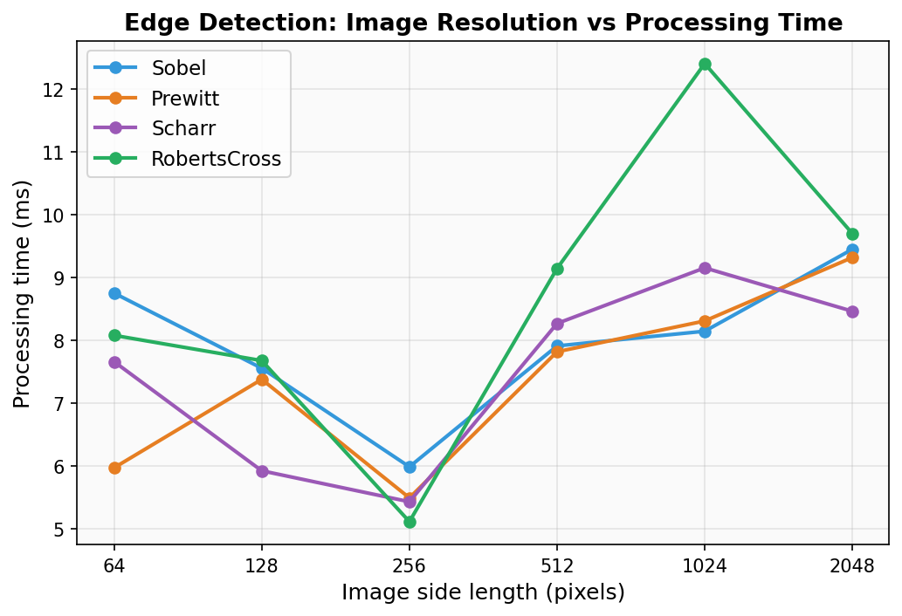

# Performance Analysis — Edge Detection Filters

Benchmark results for the four edge detection filters implemented in this project: Sobel, Prewitt, Scharr, and RobertsCross.

Each measurement is the median of 5 runs on synthetic RGB images generated at resolutions from 64×64 to 2048×2048. Benchmarks were run using the `benchmark.py` script in the project root.

---

## Image Resolution vs Processing Time

*Figure 1: Processing time across image resolutions. At small resolutions, process initialisation overhead (~5–8 ms) dominates, masking differences between filters. Computation cost becomes measurable at 512×512 and above.*
